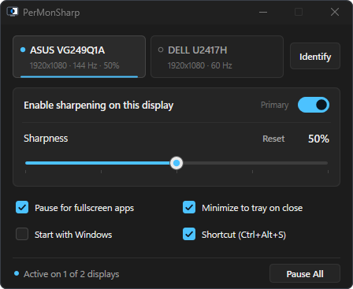

# PerMonSharp

**Lightweight Per-Monitor Sharpness Control for Windows**

[](#requirements)
[](#requirements)
[-2EA043?style=flat-square)](#getting-started)
[](LICENSE)

PerMonSharp is a native, ultra-lightweight Windows desktop utility that lets you fine-tune the perceived sharpness of each connected monitor independently in real time—without relying on coarse built-in monitor OSD menus, DDC/CI support, or GPU driver panels.

<p align="center">
  
</p>

---

## Features

- **Independent Per-Monitor Sharpness (`0%`–`100%`):** Configure and toggle sharpening separately for every connected monitor across mixed resolutions, refresh rates, DPI scaling levels, display orientations (`0°/90°/180°/270°`), and multiple GPUs. Settings are remembered automatically per physical display.
- **Desktop-Tuned Spatial Sharpening (Luma-CAS):** Enhances clarity across text, applications, browsers, images, and videos without introducing bright halos or ringing. Sharpening is computed purely in luminance so ClearType subpixel text never develops color fringing.
- **SDR & HDR Compatible:** Works seamlessly on standard 8-bit/10-bit SDR displays as well as Windows HDR desktops without clipping bright highlights.
- **Minimal Resource Footprint:** Event-driven pipeline uses **0% CPU and 0% GPU** when the screen is static or when only the mouse cursor moves, and updates only changed screen regions during typing or UI interaction. Disabled displays consume zero background resources.
- **Automatic Fullscreen & Gaming Bypass:** Automatically suspends sharpening on a monitor while a fullscreen game or video runs on it, preserving Variable Refresh Rate (G-Sync / FreeSync), frame pacing, and native gaming performance.
- **Truly Portable:** Single standalone executable (`PerMonSharp.exe`, ~411 KB) with zero installer requirements, zero external runtime dependencies, no background services, and no telemetry.

---

## Requirements

- **Operating System:** Windows 10 (Version 2004 / Build 19041 or newer) or Windows 11 (64-bit)
- **Graphics:** Direct3D 11 compatible integrated or discrete GPU

---

## Getting Started

1. Download `PerMonSharp.exe` and run it directly—no installation needed.
2. Select a monitor at the top of the window (use **Identify** to display monitor numbers on screen).
3. Turn on **Enable sharpening on this display** and adjust **Sharpness** to taste (`25%`–`45%` for subtle everyday text clarity, `50%`–`100%` for stronger definition on softer panels or media).
4. Close the window to keep PerMonSharp running quietly in the system tray.

### Controls & Shortcuts

| Input | Action |
| :--- | :--- |
| `Left` / `Down` or `Right` / `Up` | Adjust sharpness by `±1%` |
| `Shift` + Arrow Keys or `PageDown` / `PageUp` | Adjust sharpness by `±5%` |
| Mouse Wheel *(over control card)* | Adjust sharpness by `±1%` (`±5%` with `Shift`) |
| `Space` | Enable or disable sharpening on the selected monitor |
| `R` | Reset selected monitor sharpness to `35%` |
| `Tab` / `Shift+Tab` or `1`–`9` | Switch between connected monitors |
| `Ctrl+Alt+S` *(global, optional)* | Pause or resume sharpening across all monitors |
| System Tray Left-Click | Show or hide the PerMonSharp window |
| System Tray Middle-Click | Pause or resume all sharpening |
| System Tray Right-Click | Quick per-monitor toggles, Identify, Start with Windows, Exit |

### Portable Mode & Command-Line Flags

By default, settings are saved to `%APPDATA%\PerMonSharp\settings.json`. To keep settings in the same folder as `PerMonSharp.exe`, create an empty `portable.txt` file next to the executable or launch with `--portable`.

```powershell
PerMonSharp.exe                 # Normal launch (activates existing window if already running)
PerMonSharp.exe --minimized     # Start hidden in the system tray
PerMonSharp.exe --portable      # Save settings.json next to PerMonSharp.exe
PerMonSharp.exe --benchmark     # Print display info and local GPU/VRAM benchmark
```

---

## Resource Usage

| Metric | Typical Value |
| :--- | :--- |
| **Executable Size** | `~411 KB` (standalone `.exe`) |
| **Idle CPU / GPU (static desktop or cursor movement)** | `0.0%` CPU / `0.0%` GPU (`0 ms` cursor latency) |
| **System Tray Idle Memory (0 displays active)** | `~8.5 MB` RAM / `0 MB` VRAM |
| **Dedicated VRAM per Active Sharpened Display** | `~23 MB` (1080p) · `~44 MB` (1440p) · `~93 MB` (4K) |
| **GPU Shader Time (full-frame update)** | `~0.10–0.25 ms` (1080p) · `< 0.002 ms` (typing / small UI updates) |

---

## Windows Limitations

Because PerMonSharp uses official, supported Windows desktop APIs rather than system injection or kernel drivers, a few standard Windows behaviors apply:

- **Fullscreen Games:** Keep **Pause for fullscreen apps** enabled (default) so PerMonSharp automatically disables the desktop overlay during fullscreen games, allowing native DirectFlip and G-Sync / FreeSync operation.
- **DRM-Protected Streaming Video:** Hardware-DRM video streams (such as Netflix or Prime Video in Edge/app) are blanked by Windows Output Protection while any desktop capture utility is active on that monitor. Press `Ctrl+Alt+S` or middle-click the tray icon to pause sharpening while watching DRM-protected content.
- **Screenshots & Screen Recording:** Screenshot and recording tools (Snipping Tool, OBS) capture the clean, unmodified desktop rather than the sharpened overlay.
- **System Overlays:** Privileged Windows shell surfaces (Start Menu, `Alt+Tab`, Always-on-Top Task Manager, and UAC prompts) render above desktop overlays and appear unsharpened.

---

## Building from Source

Requires Windows 10/11 (x64), **Visual Studio 2022** (or C++ Build Tools with the Windows 10/11 SDK), and **CMake 3.20+**.

```powershell
.\build.ps1
```

The build script precompiles the HLSL shaders, builds the static Release executable into `dist\PerMonSharp.exe`, and runs the automated verification test suite.

---

## License

Licensed under the [MIT License](LICENSE).
